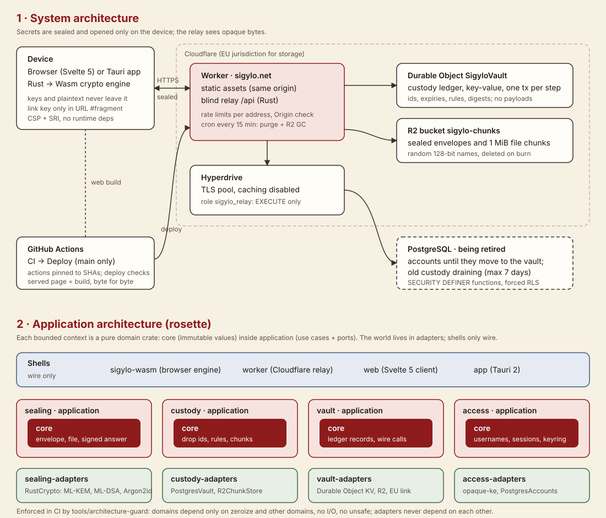

# Sigylo

**English** · [Italiano](README.it.md)

The digital seal for your secrets. Write a password, choose whether it is destroyed on first read or at an expiry, send the link. The secret is encrypted in your browser; the server keeps only unreadable data and destroys it as you decided.

Production: **https://sigylo.net**.

Specification, architecture and development rules: [CLAUDE.md](CLAUDE.md).

## How it works

- **Link:** a random 256-bit key, only in the link's `#` fragment, which browsers never send to servers. Optionally a passphrase (Argon2id) to send over another channel.
- **Request, post-quantum:** the recipient creates a hybrid X25519 + ML-KEM-768 key pair on their own device; the sender seals with that key. No reading key ever travels.
- **Files up to 10 MiB:** a manifest sealed like any secret carries the file key; the file travels in 1 MiB chunks authenticated with their position and total count, and a read-once file goes, chunk by chunk, only to whoever opened it. Chunks live on Cloudflare R2 (EU) under random names.
- **Blind relay:** a Rust Cloudflare Worker keeps opaque envelopes: the ledger lives in a Durable Object in the EU, the envelopes on R2. Atomic burn-after-reading, expiry from 5 minutes to 7 days, revocation by the sender.
- **Optional accounts:** OPAQUE login (the password never leaves the device), on PostgreSQL via Hyperdrive until accounts move to the vault.



## Quick start

```bash
cargo test --workspace
cargo run -p architecture-guard
bash supabase/tests/run.sh
(cd web && npm ci && npm run build && npm test)
bash scripts/e2e.sh
```

Installable app (Tauri, desktop and ready for mobile): see [app/README.md](app/README.md).

Code licence: Apache-2.0 (see [LICENSE](LICENSE) and [NOTICE](NOTICE)). Use of the service at sigylo.net is governed by the terms of service and the privacy policy, linked from the site footer.
